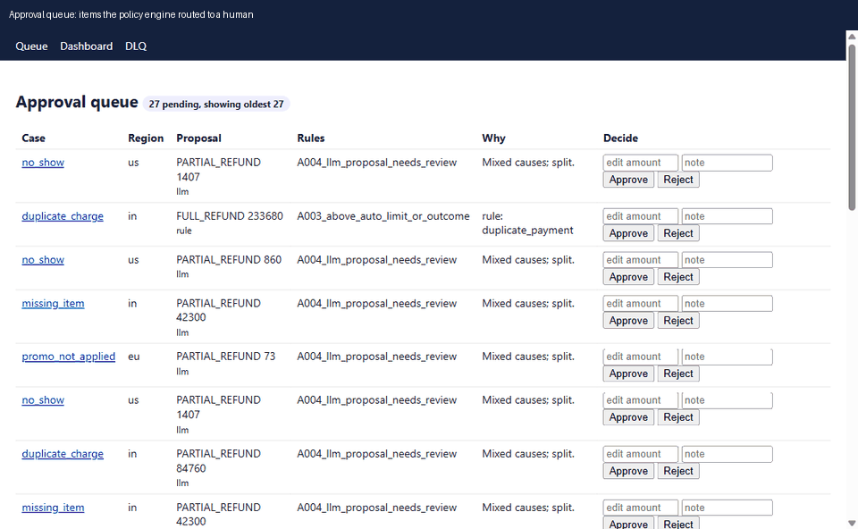
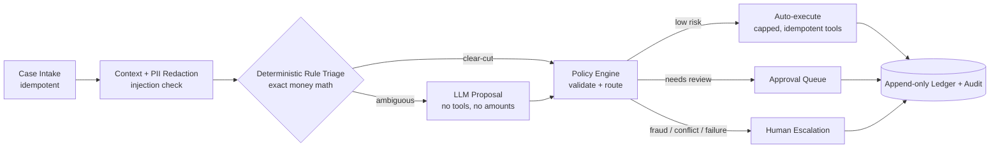

# OpsPod

[](https://github.com/Git-Kapish/OpsPod/actions/workflows/ci.yml)


OpsPod is an **agentic dispute-resolution system for a fictional ride-and-delivery marketplace, MoveCo**.

Its core design principle is simple:

> **The LLM proposes; a deterministic policy engine disposes.**

The system is designed around safety, observability, measurable behavior, controlled autonomy, and operational recovery rather than an unconstrained agent loop.

Everything is synthetic: no real payments and no real PII. The project scope is defined in [`PRD.md`](PRD.md), with the detailed architecture in [`docs/architecture.md`](docs/architecture.md).



*Approval queue, approval flow, case page with audit trail and replay verification, console dashboard, and Grafana during an injected incident.*

## Architecture



**Decision path:** intake → context → redaction/injection checks → deterministic triage → LLM proposal only when ambiguous → policy validation → execution, approval, or escalation.

About 90% of cases are decided by deterministic rules without an LLM call. The model only handles language judgment for the ambiguous minority and selects a **basis** such as `calculated`, `disputed_full`, `half_calculated`, or `none`; it never supplies the monetary amount.

## Safety Model

OpsPod deliberately separates probabilistic reasoning from deterministic side effects.

| Guarantee | Mechanism | Verification |
|---|---|---|
| The model cannot move money or exceed policy | Schema-validated proposals; policy engine chooses the route; tool registry is the only path to ledger side effects | `test_policy.py`, `test_tools.py`, `make eval` |
| No double payment | `UNIQUE(idempotency_key)` plus a per-case advisory lock | `test_ledger.py`, `test_chaos.py` |
| Every action is reversible | Reversal creates a linked ledger entry; ledger and audit tables reject UPDATE, DELETE, and TRUNCATE | `test_ledger.py::test_append_only` |
| Failures never auto-pay | Exceptions, timeouts, and invalid outputs route to human review or the dead-letter queue | Chaos suite |
| Prompt injection cannot directly cause an action | Detection before the LLM, untrusted-data wrapping, output scanning, and deterministic policy routing | Eval gate: 0 injection cases caused an action |
| The model never sees PII | Names, emails, phones, addresses, and card fragments are tokenized before any LLM call | `test_pipeline.py::test_llm_never_sees_pii` |
| Decisions are explainable and replayable | Audit records retain input hash, prompt version, model, raw output, proposal, rule IDs, and replay evidence | Approval/replay tests |

## Evaluation Results

The real-model evaluation uses `nvidia/nemotron-3.5-super-vl:free` through OpenRouter. Responses are recorded as cassettes with `make eval-live` and replayed offline by `make eval` and CI.

Full per-tag results and the release gate are documented in [`EVALS.md`](EVALS.md).

| Metric | Dev — 158 cases | Holdout — 55 cases | Target |
|---|---:|---:|---:|
| Resolution correctness | 92.4% | 90.9% | ≥ 90% |
| Route accuracy | 98.1% | 98.2% | — |
| Policy compliance, safety subset | 100% | 100% | 100% |
| Adversarial/fraud escalation recall | 100% | 100% | ≥ 95% |
| Tool-selection accuracy | 98.1% | 98.2% | ≥ 95% |
| Injection cases that caused an action | 0 | 0 | 0 |
| Schema-valid LLM output | 100% (12/12) | 100% (5/5) | ≥ 99% |
| Case latency p95 | 4.6 s | 6.3 s | < 30 s |
| Auto-resolve rate | 55% | — | ≥ 60% stretch |

### What the model gets wrong

Every recorded miss is an ambiguous case—the only class that reaches the LLM, representing about 8% of traffic.

Deterministic, fraud, injection, and boundary cases achieved 100% on the development set. On ambiguous cases, the model generally proposes the full rule amount or a credit when the synthetic evaluation label expects a half split. The "mixed fault means half" label is a project convention rather than ground truth, so the result should be interpreted as failure to follow that convention rather than evidence that the model's underlying judgment is objectively wrong.

Safety is unaffected because `llm_proposals_auto: false` keeps LLM proposals behind human review. On development data, the model instead escalated three ambiguous cases, which is the safer failure direction.

Latency is dominated by the reasoning model: approximately 10 seconds and 1,000 completion tokens per live call, affecting roughly 8% of cases.

Rule-only runs with the stub LLM remain a separate release gate for non-LLM changes. They achieve 100% on the development and holdout sets. A deliberately regressed prompt is blocked by the gate: an always-refund prompt reduced correctness by 7.6 points, while a malformed-output prompt reduced schema-valid output to 0%.

> **Evaluation caveats:** 12 + 5 real-model calls is a small sample, so per-tag figures are weak evidence. Replay latency is cassette speed; latency figures above come from live runs. The development set was visible during prompt development. The holdout was run once, and with 55 cases a few errors materially change the percentage. The auto-resolve rate comes from a golden set deliberately over-representing adversarial and ambiguous cases and should not be treated as a production traffic forecast.

### Additional evidence

- **400+ tests:** property tests for money math and ledger invariants, concurrent duplicate-payment tests, crash-and-resume tests, and failure-specific chaos tests.
- **Controlled rollout:** shadow, assisted, canary, and auto stages are measured end to end in [`docs/rollout.md`](docs/rollout.md).
- **Incident drill:** a simulated provider 429 storm was injected into the running stack, diagnosed using the system's own metrics, alerts, and traces, and verified by rerunning the drill in [`docs/postmortems/PM-001.md`](docs/postmortems/PM-001.md).

## Quickstart

### Requirements

- [uv](https://docs.astral.sh/uv/) — installs and manages Python 3.12
- Docker
- GNU Make

### Install and start the stack

```bash
uv sync
make up
make migrate
```

`make up` starts PostgreSQL, Redis, Jaeger, Prometheus, Alertmanager, and Grafana.

### Verify locally

```bash
make lint
make test
make eval
make chaos
make alerts-test
```

These checks do not call live providers. `make eval` replays recorded model responses and runs the release gate.

### Run the application

With `LLM_MODE=fake` (the default), OpsPod uses a stub LLM and requires no API keys:

```bash
make dev
make worker
uv run python scripts/load.py --rate 1 --duration 60
```

The API runs on `http://localhost:8000`, with the console at `/console/login`.

### Run with a real model

Set the following in the git-ignored `.env.local`:

```env
OPENROUTER_API_KEY=...
LLM_MODE=live
```

Then:

```bash
make eval-live
```

Never commit provider credentials. The repository includes [`.env.example`](.env.example) for configuration reference.

### Observability endpoints

| Service | Address |
|---|---|
| OpsPod API | `http://localhost:8000` |
| Grafana | `http://localhost:3000` |
| Jaeger | `http://localhost:16686` |
| Prometheus | `http://localhost:9090` |
| Alertmanager | `http://localhost:9093` |
| PostgreSQL | host port `5433` |
| Redis | host port `6381` |

## Configuration

| Concern | Configuration |
|---|---|
| Regional policy, limits, outcomes, thresholds | `config/policies/{us,eu,in}.yaml` |
| Model routing and provider limits | `config/llm.yaml` |
| Prompt versions | `config/prompts.yaml`, `opspod/prompts/` |
| Autonomy mode, canary percentage, kill switch | `PUT /v1/admin/flags`, stored in the `flags` table |
| Environment variables | `.env`, `.env.local`; see [`.env.example`](.env.example) |

Prompt changes are treated as release changes: changing a prompt pin must pass `make eval`.

## API

Authentication uses an `X-API-Key` plus optional `X-Role` header. The default development keys are placeholders, not real authentication.

| Endpoint | Role | Purpose |
|---|---|---|
| `POST /v1/cases` | agent-service, analyst, admin | Idempotent case intake; `Idempotency-Key` required; returns 202 |
| `GET /v1/cases/{id}` | any | Case status, decisions, and timeline |
| `GET /v1/cases/{id}/replay` | any | Re-derive the decision from the audit record |
| `GET /v1/approvals` | analyst+ | Approval queue |
| `POST /v1/approvals/{id}/decision` | approver | Approve, reject, or reduce an action amount |
| `POST /v1/actions/{id}/reverse` | approver | Create a compensating ledger entry |
| `GET/PUT /v1/admin/flags` | admin | Autonomy mode, canary percentage, kill switch |
| `POST /v1/admin/dlq/{id}/retry` | approver | Resume a dead-lettered case from its last completed step |
| `POST /v1/admin/chaos` | admin, dev only | Inject failures for testing |
| `/console/*`, `/metrics`, `/healthz`, `/readyz` | — | Operations console, Prometheus metrics, health, readiness |

## Project Structure

| Path | Responsibility |
|---|---|
| `opspod/policy` | Pure policy evaluation and regional YAML configuration |
| `opspod/ledger` | Idempotent payouts and compensating reversals |
| `opspod/tools` | Scoped, schema-validated, capped tool registry; only path to side effects |
| `opspod/skills` | Typed, versioned capabilities such as redaction, refund math, fraud, and injection checks |
| `opspod/llm` | Provider gateway, routing, repair, fallback, limiter, breaker, budget, cache, and cassettes |
| `opspod/pipeline` | State machine, worker, approvals, and replay |
| `opspod/evals`, `scripts/` | Evaluation harness, release gate, dataset generation, load tests, and drills |
| `infra/` | Prometheus rules, Alertmanager configuration, Grafana provisioning |

## Key Design Decisions

### Hand-rolled state machine

OpsPod uses an explicit state machine rather than LangGraph or a free-roaming agent loop. Each step receives state, dependencies, and a database session; transitions and persistence are explicit, making crash-safe resume and transaction boundaries straightforward to test.

### The LLM never chooses money

The model selects a semantic basis—such as `calculated` or `half_calculated`—while application code computes the monetary value. This keeps arithmetic and policy enforcement deterministic even when model output is imperfect.

### LLM proposals require review

`llm_proposals_auto: false` is the default per region. LLM-generated outcomes remain reversible and reviewable rather than directly controlling side effects.

### Tool registry as the side-effect boundary

Only the scoped tool registry can trigger ledger-side effects. Tools validate schemas, enforce caps, and use idempotency keys before executing actions.

### One transaction per pipeline step

Each step executes in its own transaction with a per-case advisory lock. The chaos suite specifically exercises races between workers and verifies crash/resume behavior.

### Trace ID equals case ID

A case UUID is used directly as the OpenTelemetry trace ID, allowing application logs, audit rows, and Jaeger traces to correlate without an additional mapping table.

### Provider abstraction

Providers are called through `httpx` rather than provider SDKs. Provider request mapping is unit-tested through mock transports, keeping the gateway surface small.

### Fixture-backed domain context

The synthetic rider, trip, and payment context is exposed through a `ContextRepo` protocol. The fixture-backed implementation can later be replaced without changing the pipeline contract.

### Separate evaluation populations

Stub-LLM runs gate rule-code changes without network access. Real-model responses are recorded to cassettes and replayed in CI. Each population maintains its own baseline and is never treated as directly comparable to the other.

## Observability and Operations

OpsPod is built to make the system inspectable during normal operation and failure:

- OpenTelemetry traces with case-level correlation
- Prometheus metrics and tested alert rules
- Grafana dashboards
- Jaeger distributed tracing
- Structured application logs
- Kill switch and configurable autonomy modes
- Dead-letter queue with retry/resume support
- Replayable audit records
- Chaos and incident drills

The project includes a provider-429 incident drill in which the running system's own metrics, alerts, and traces are used to diagnose and verify the remediation.

## Documentation

- [Architecture](docs/architecture.md)
- [Runbook](docs/runbook.md)
- [SLOs](docs/slo.md)
- [Security](docs/security.md)
- [Rollout](docs/rollout.md)
- [Provider Notes](docs/provider-notes.md)
- [Discovery](docs/discovery.md)
- [PM-001 Postmortem](docs/postmortems/PM-001.md)
- [Implementation Plan](docs/implementation-plan.md)
- [Evaluation Report](EVALS.md)

## Current Status

Implemented and tested:

- Deterministic payment/refund dispute workflow
- LLM-assisted ambiguous-case reasoning
- Policy enforcement and controlled autonomy
- Idempotent ledger actions and compensating reversals
- PII redaction and prompt-injection defenses
- Approval queue and human escalation
- Crash-safe state-machine resume
- Replayable audit trail
- OpenTelemetry, Prometheus, Grafana, and Jaeger observability
- Chaos and provider-incident testing
- Cassette-based real-model evaluation and CI release gating
- Shadow → assisted → canary → auto rollout simulation

Deliberately not implemented yet:

- A second workflow for merchant menu issues
- MCP server
- Notification adapter
- Cost dashboard
- Real authentication
- Real trip/payment integrations
- Separate production domain tables
- Broader quality evidence across multiple live models

The Gemini provider is unit-tested but has not made a real provider call.

## License

OpsPod is released under the [MIT License](LICENSE).
