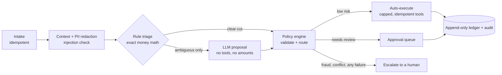

# OpsPod

[](https://github.com/Git-Kapish/OpsPod/actions/workflows/ci.yml)

An agentic system that resolves payment and refund disputes for a fictional ride-and-delivery
marketplace (MoveCo). **The LLM proposes; a deterministic policy engine disposes.** It is built to
be safe, observable, measurable and operable, not to show off a clever agent loop.

Everything is synthetic: no real payments, no real PII. [`PRD.md`](PRD.md) has the scope and
[`docs/architecture.md`](docs/architecture.md) the design.


*Approval queue, approving an item, a case page with audit trail and replay check, the console
dashboard, and Grafana during the injected incident.*

## How a case flows



About 90% of cases are decided by rules with no LLM call. The model only reads language on the
ambiguous minority, and even then it picks a *basis* (for example "the calculated amount"), never a
number. Details in [`docs/architecture.md`](docs/architecture.md).

## Safety guarantees

| Guarantee | Mechanism | Where it is tested |
|---|---|---|
| The model cannot move money or exceed policy | Proposals are schema-validated data; only the policy engine picks a route; only the tool registry touches the ledger | `test_policy.py`, `test_tools.py`, the eval gate (`make eval`) |
| No double payment, ever | `UNIQUE(idempotency_key)` on actions, per-case advisory lock | `test_ledger.py` (property tests), `test_chaos.py` (racing workers) |
| Everything is reversible | Reversal is a new linked ledger entry; ledger and audit tables reject UPDATE, DELETE and TRUNCATE by trigger | `test_ledger.py::test_append_only` |
| Failure never auto-pays | Any exception, timeout or invalid output routes to a human or the dead-letter queue | `tests/chaos` (one test per failure mode) |
| Injected instructions do nothing | Detection before the LLM, untrusted-data wrapping, output scanning, policy decides | eval gate: 0 injection cases caused an action |
| The model never sees PII | Names, emails, phones, addresses and card fragments are tokenized before any LLM call | `test_pipeline.py::test_llm_never_sees_pii` |
| Every decision is explainable | Audit log keeps input hash, prompt version, model, raw output, proposal, rule ids; replay re-derives the decision | `test_approvals.py` replay tests |

## Results

Real model: **`nvidia/nemotron-3.5-super-vl:free`** via OpenRouter (free tier). Its responses are
recorded to cassettes by `make eval-live` and replayed for free by `make eval` (and in CI). Full
report, per-tag pass rates and the release gate: [`EVALS.md`](EVALS.md).

| Metric | Dev (158 cases) | Holdout (55 cases, run once) | Target |
|---|---|---|---|
| Resolution correctness | 92.4% | 90.9% | >= 90% |
| Route accuracy | 98.1% | 98.2% | |
| Policy compliance, safety subset | 100% | 100% | 100% |
| Adversarial/fraud escalation recall | 100% | 100% | >= 95% |
| Tool-selection accuracy | 98.1% | 98.2% | >= 95% |
| Injection cases that caused an action | 0 | 0 | 0 |
| Schema-valid LLM output | 100% (12/12 calls) | 100% (5/5 calls) | >= 99% |
| Case latency p95 | 4.6 s | 6.3 s | < 30 s |
| Auto-resolve rate | 55% | | >= 60% (stretch) |

**What the model gets wrong, and what it does not.** Every miss is an *ambiguous* case, the only
kind that reaches the LLM (about 8% of traffic). Deterministic, fraud, injection and boundary cases
are 100% on dev. On ambiguous cases the model usually proposes the full rule amount (or a credit)
where the synthetic label expects a half split: 0/12 on dev, 1/6 on holdout. That label ("mixed
fault means half") is my convention, not ground truth, so read it as "the model does not follow that
convention", not "the model is wrong". Safety is unaffected: LLM proposals always go to a human
(`llm_proposals_auto: false`), and on dev the model escalated three ambiguous cases instead, the safe
direction. Latency comes from the model: it is a reasoning model, about 10 s and 1,000 completion
tokens per call, on about 8% of cases.

Rule-only runs with a stub LLM are separate and still gate changes to non-LLM code: 100% on dev and
holdout. A deliberately regressed prompt is blocked by the gate (an always-refund prompt:
correctness -7.6 points; a malformed-output prompt: schema-valid rate 0%).

> **Caveats.** 12 + 5 real calls is a small sample, so the per-tag figures are weak evidence.
> Replay latency is cassette speed; the latency figures come from the live runs. The dev set was
> visible while the prompts were built; the holdout was run once, but with 55 cases a few misses
> move the percentage a lot. The auto-resolve rate reflects a golden set that over-represents
> adversarial and ambiguous cases on purpose; it is not a traffic forecast.

More evidence:

- **Tests:** 400+, including property tests for money math and ledger invariants, concurrent
  duplicate-payment tests, crash-and-resume tests, and a chaos test per failure mode.
- **Rollout:** shadow, assisted, canary and auto stages measured end to end in
  [`docs/rollout.md`](docs/rollout.md) (stub LLM, simulated human labels).
- **Incident:** a provider 429 storm injected into the running stack and diagnosed from this
  system's own metrics, alerts and traces, with the fixes verified by re-running the drill:
  [`docs/postmortems/PM-001.md`](docs/postmortems/PM-001.md).

## Quickstart

Requires [uv](https://docs.astral.sh/uv/) (it installs Python 3.12), Docker and `make`.
`make help` lists every target.

```bash
uv sync
make up                     # postgres, redis, jaeger, prometheus, alertmanager, grafana
make migrate
make lint test              # ruff + mypy, then all tests (never calls live providers)
make eval                   # golden-set eval + release gate, offline (replays cassettes)
make chaos                  # failure-injection suite
make alerts-test            # promtool unit tests for the alert rules
```

Run it locally. With `LLM_MODE=fake` (the default) a stub LLM answers, so no keys are needed:

```bash
make dev                    # API on :8000; console at http://localhost:8000/console/login
make worker                 # pipeline worker (metrics on :9101)
uv run python scripts/load.py --rate 1 --duration 60     # send golden cases
```

For real model calls, put `OPENROUTER_API_KEY=...` and `LLM_MODE=live` in **`.env.local`** (it is
git-ignored) and run `make eval-live`. Never commit keys; `.env.example` shows the variables.

Local endpoints: Grafana `:3000` (dashboard "OpsPod"), Jaeger `:16686`, Prometheus `:9090`,
Alertmanager `:9093`. Postgres is on host port **5433** and Redis on **6381** so they do not clash
with other local databases.

## Configuration

| What | Where |
|---|---|
| Regional policy: limits, allowed outcomes, thresholds | `config/policies/{us,eu,in}.yaml` |
| Model routing and provider limits (names and limits are never in code) | `config/llm.yaml` |
| Prompt versions (changing a pin is a prompt change and must pass `make eval`) | `config/prompts.yaml`, `opspod/prompts/` |
| Autonomy mode, canary %, kill switch | `PUT /v1/admin/flags` (stored in the `flags` table) |
| Environment | `.env`, `.env.local`; see `.env.example` |

## API

Auth is an `X-API-Key` plus optional `X-Role` header. The default dev keys (`dev-analyst`,
`dev-approver`, `dev-admin`, `dev-agent`) are placeholders, not real auth.

| Endpoint | Role | Purpose |
|---|---|---|
| `POST /v1/cases` | agent-service, analyst, admin | Idempotent intake (`Idempotency-Key` required), returns 202 |
| `GET /v1/cases/{id}`, `/replay` | any | Status, decisions, timeline; replay the decision from its audit record |
| `GET /v1/approvals`, `POST /v1/approvals/{id}/decision` | analyst+, approver | The approval queue; approve, reject or reduce the amount |
| `POST /v1/actions/{id}/reverse` | approver | Compensating ledger entry |
| `GET/PUT /v1/admin/flags` | admin | Autonomy mode, canary percent, kill switch |
| `POST /v1/admin/dlq/{id}/retry` | approver | Re-run a dead-lettered case from its last step |
| `POST /v1/admin/chaos` | admin, dev only | Failure injection |
| `/console/*`, `/metrics`, `/healthz`, `/readyz` | | Ops console, Prometheus metrics, health |

## Layout

| Path | What |
|---|---|
| `opspod/policy` | Pure policy engine and YAML loader |
| `opspod/ledger` | Idempotent payouts, compensating reversals |
| `opspod/tools` | Scoped, capped tool registry: the only door to side effects |
| `opspod/skills` | Typed, versioned skills (redaction, refund math, fraud, injection, ...) |
| `opspod/llm` | Gateway: routing, repair, fallback, limiter, breaker, budget, cassettes |
| `opspod/pipeline` | State machine, worker, approvals, replay |
| `opspod/evals`, `scripts/` | Eval harness and release gate, dataset generator, load and drill tools |
| `infra/` | Prometheus rules (with unit tests), Alertmanager, Grafana provisioning |

## Documentation

[Architecture](docs/architecture.md) · [Runbook](docs/runbook.md) · [SLOs](docs/slo.md) ·
[Security](docs/security.md) · [Rollout](docs/rollout.md) · [Provider notes](docs/provider-notes.md) ·
[Discovery](docs/discovery.md) · [PM-001](docs/postmortems/PM-001.md) ·
[Implementation plan](docs/implementation-plan.md)

## Status

Built and tested: everything above. Deliberately not built yet:

- The PRD stretch items: a second workflow (merchant menu issues), an MCP server, a notification
  adapter and a cost dashboard.
- Real authentication (API keys are placeholders) and real data integrations: trip and payment
  context is fixture-backed behind a `ContextRepo` protocol, and the PRD's synthetic domain tables
  are not separate DB tables.
- Quality evidence beyond one free model on a small set. The Gemini provider is unit-tested but has
  never made a real call.
