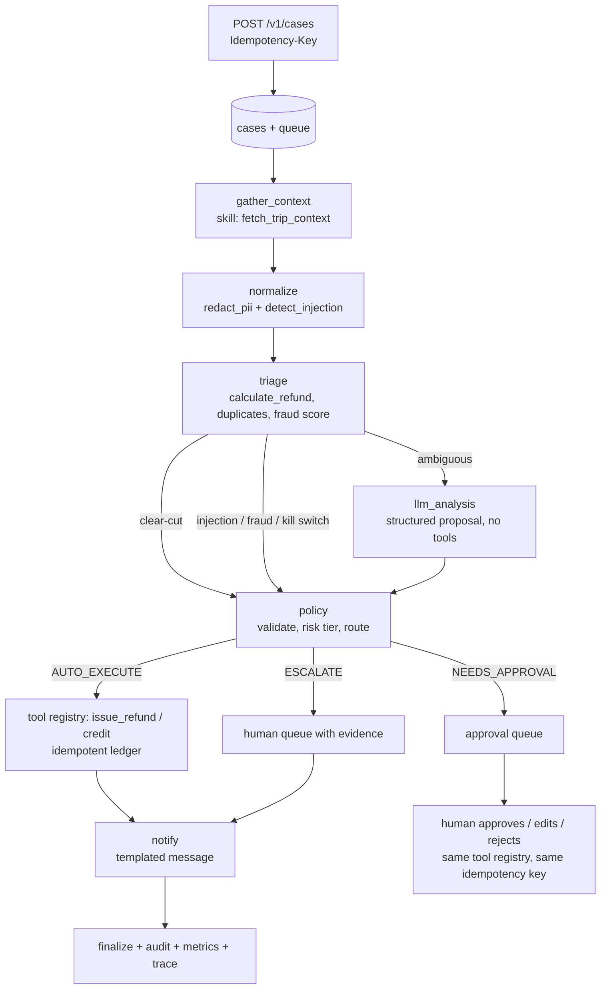

# Architecture

**The LLM proposes. The policy engine disposes.** The model can recommend an outcome; a
deterministic policy engine is the only authority on what happens, at what amount, in which
region, in which autonomy mode.

## Pipeline

An explicit state machine, not a free-roaming agent loop. State is snapshotted after every step, so
a crash resumes from the last completed step.

Failure at any step: retry with backoff, then dead-letter (a human queue). Never auto-execute on
error. Order differs slightly from the PRD diagram: `gather_context` runs before `normalize`
because redaction needs the rider's name from context (context is internal; nothing reaches an
LLM before normalize).

## Layers

`api -> pipeline -> skills/tools -> ledger/db`. Only `llm/` talks to providers. Only `ledger/`
writes money rows. Only `policy/` decides routes.

| Package | Responsibility |
|---|---|
| `policy/` | Pure `evaluate(policy, proposal, facts)`; YAML regional config; canary bucketing |
| `ledger/` | Idempotent payouts, compensating reversals, day-spend and frequency queries |
| `tools/` | Registry: scope, schema validation, caps; the only door to side effects |
| `skills/` | Typed, versioned capabilities (redaction, refund math, fraud score, ...) |
| `llm/` | Gateway: routing, repair retry, fallback, limiter, breaker, budget, cache, cassettes |
| `pipeline/` | Steps, runner (advisory lock, resume), intake, worker, approvals, replay |
| `observability/` | OpenTelemetry spans (trace id = case id), Prometheus metrics |
| `evals/` | Harness, metrics, release gate, stubs |

## Data flow and what is stored

- `cases.payload_json` holds the raw intake (synthetic). `case_steps.state_json` holds pipeline
  state with **no** rider names. The audit log holds the redacted text, never the mapping.
- `ledger_entries` and `audit_log` are append-only by trigger. Reversals are new rows.
- Flags (`autonomy`, `kill_switch`, `chaos`) live in the `flags` table and are read fresh, so the
  kill switch takes effect mid-case.

## Decision records

1. **Hand-rolled state machine over LangGraph.** A step is a function `(state, deps, session)`;
   transitions, persistence and resume are ~100 lines and fully testable. A framework would hide
   the exact thing we need to prove (crash-safe resume, one-transaction steps).
2. **LLM output never carries an amount.** The model picks a basis (`calculated`,
   `disputed_full`, `half_calculated`, `none`); code computes the number. Weak free models do
   language judgment, not arithmetic.
3. **LLM-sourced proposals need review by default** (`llm_proposals_auto: false` per region).
   Reversible per region in YAML; it trades auto-resolve rate for safety while free models are
   unproven.
4. **Provider REST over SDKs.** OpenRouter and Gemini are called with `httpx`, so request mapping
   is unit-tested with mock transports and there is no SDK surface to keep in sync.
5. **One transaction per step, plus a per-case advisory lock.** Found by the chaos suite: two
   workers racing one case collided on the step-attempt unique key. The loser now backs off
   (`CaseLocked`). Payments were never at risk (ledger idempotency), but errors were noisy.
6. **Trace id = case id.** A case id is a UUID (128 bits), which is exactly an OpenTelemetry trace
   id, so logs, audit rows and Jaeger correlate on one value with no mapping table.
7. **Fixture-backed context repository.** The synthetic domain tables from the PRD (riders, trips,
   payments) are served from the golden dataset through a `ContextRepo` protocol. Swapping in a
   DB-backed repo touches one class.
8. **Two eval populations.** Stub-LLM runs (label-blind, no network) gate changes to rule code and
   always run; real-model runs are recorded to cassettes (`make eval-live`) and replayed free in CI
   (`make eval`). Each has its own baseline (`evals/baseline.json`, `evals/baseline-real.json`) and
   they are never compared with each other. Stub runs ignore `config/llm.yaml` so real-provider
   rate limits cannot leak into them.
